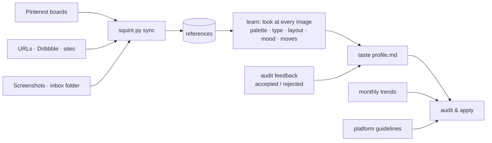

# Squint

> Designers squint at a screen to see what really stands out. Squint does that for your whole product.

**A UI/UX and branding art director for Claude Code that lives in your repo.** It keeps up with design trends every
month, learns *your* taste from Pinterest boards and screenshots, and audits web, iOS and Android
products. You get a plan and visual before/after concepts first. The product changes only when you approve.

[Русская версия](README.ru.md)

```
/squint:setup                            # one-time: tools, first moodboard, monthly schedule
/squint:moodboard add https://pinterest.com/you/your-board/
"analyse my project and suggest improvements"
→ report.md + concepts.html (before / after mockups, scores, directions, positioning)
"apply R1 R3 R5"                         # only now does it touch your code
```

## What it does

| | |
|---|---|
| 🔭 **Researches trends monthly** | Parallel scouts cover **web, iOS, Android and branding/positioning** with dated sources and track momentum month to month (new ↑ → ↓ fading). The base ships with the plugin, refreshed monthly by a GitHub Action, and you can also run it locally on a schedule. |
| 🎨 **Learns your taste** | Add Pinterest boards, Dribbble/Behance/site links, screenshots or folders. It studies every image (palette, type, layout, shape, mood, signature moves) and keeps a **taste profile** that you can read and edit. Your accepted and rejected recommendations train it too. |
| 🔍 **Audits your product** | Detects the stack (Next/React/Vue/Svelte, SwiftUI/UIKit, Compose/Views, React Native/Expo, Flutter), takes real screenshots (browser, iOS Simulator, Android emulator), and scores UX, UI, accessibility, platform fit, brand and positioning with evidence (`file:line`, screenshots, measured contrast, design-system-debt counts). |
| 🖼 **Shows before it changes** | `report.md` lays out quick wins, core changes and bold moves, each with its basis (guideline · trend id · your taste · data). `concepts.html` puts every change as a real "before" screenshot next to an HTML "after" mockup in an iPhone, Android or browser frame, and tick-boxes build the approval command. |
| 🛠 **Applies on approval** | Tokens → components → screens → copy, on a branch, verified with after-screenshots, logged in `decisions.md`. |
| 📣 **Positioning too** | 5-second test, competitor research, 2–3 positioning options, headlines, App Store / Google Play listing, tone of voice. |

Platform-aware throughout: iOS is judged by iOS conventions and iOS trends (e.g. the current Liquid
Glass generation), Android by Material 3 Expressive, web by WCAG 2.2, Core Web Vitals and web trends.
Cross-platform apps get a "brand-consistent core, platform-native shell" review.

## Install

```bash
claude plugin marketplace add DEVBUFF/squint
claude plugin install squint@squint
```

Or inside Claude Code: `/plugin marketplace add DEVBUFF/squint`, then `/plugin install squint@squint`.
Restart Claude Code, then run `/squint:setup`.

**Device tools (optional companion).** To let audits screenshot and click through your product in a real
browser, the iOS Simulator and the Android emulator, also install
[`squint-devices`](https://github.com/DEVBUFF/squint-devices) from the same marketplace:

```bash
claude plugin install squint-devices@squint
```

**Requirements:** Claude Code, Python 3.9+, Google Chrome. Node.js 20+ only for the `squint-devices`
companion. Optional: Xcode (iOS Simulator), Android platform-tools + emulator, Pillow
(`pip install pillow`, for exact palette extraction).

**Updates:** `claude plugin update squint@squint`, or enable auto-update in
`/plugin` → Marketplaces. Merged monthly trend PRs bump the version.

## Who pays for what

Squint has no server and ships no keys. Everything it does (audits, `apply`, `learn`,
`positioning`, `research`) runs in **your own Claude Code session**, so it uses **your** Claude
subscription (Pro / Max) or your API key, whichever you are logged in with. The local monthly
schedule runs `claude -p` under the same login.

The only thing paid by the maintainer is the shared trend base: once a month a GitHub Action
researches trends on the maintainer's subscription and ships them to everyone with the next plugin
update. The `squint-devices` servers run locally; Exa search uses its free keyless tier.

## Skills

| Command | Natural language works too | What happens |
|---|---|---|
| `/squint:audit [focus]` | "analyse my project and suggest improvements", "проанализируй мой проект" | Full audit → `report.md` + `concepts.html`. Does not edit the product. |
| `/squint:apply R1 R3` | "apply quick wins", "go with direction B" | Implements the approved items and verifies them with after-screenshots. |
| `/squint:moodboard add <url\|path>` | "add my Pinterest board", "вот что мне нравится" | Registers / syncs sources, imports screenshots and the inbox. |
| `/squint:learn` | "learn my taste", "изучи мои референсы" | Analyses new references and rebuilds the taste profile. |
| `/squint:research` | "update design trends", "обнови тренды" | Monthly trend research → `~/.squint/trends/<YYYY-MM>/`. |
| `/squint:positioning` | "help me position the product", "перепиши оффер" | Positioning options, messaging, headlines, store listing, voice. |
| `/squint:setup` | "set up the art director" | Tool check, optional connections, monthly schedule, first moodboard. |

Agents used under the hood: `trend-scout`, `reference-analyst`, `ux-auditor`, `brand-strategist`.

## How it learns



When signals conflict, recommendations follow **brief → accessibility & platform guidelines →
project moodboard → your taste → trends**. A trend is a tool, never a goal, and every audit includes
a "deliberately not recommended" list.

- **Global taste** (`~/.squint/`) follows you across projects.
- **Project moodboard** (`<project>/.squint/`, use `--project`) applies to one product only.
- **Inbox**: drop images into `~/.squint/inbox/` (subfolders become tags), then run
  `/squint:learn`. A session-start reminder tells you when references are waiting.

**Pinterest:** public boards sync through their RSS feed, which returns the 25 newest pins per sync.
For larger boards, the moodboard skill can collect pins through a browser MCP (e.g. `squint-devices`).
**Are.na** doesn't allow automated access, so connect its official MCP with your own login or save
images into the inbox.

## Monthly research: three layers

1. **Shipped base.** `.github/workflows/monthly-trends.yml` runs on the 1st of each month, researches
   the four areas with Claude Code, validates the format and opens a PR. Merged PRs reach everyone
   through plugin updates.
2. **Your personal base.** `/squint:setup` can install a launchd (macOS) or cron (Linux) job:
   `scripts/schedule.sh install`. It runs `claude -p "/squint:research"` on the 1st with only
   research tools pre-approved. You can also run `/squint:research` any time.
3. **Reminder.** If the newest base is older than 35 days, Claude offers a refresh at session start.

Trend files follow [`knowledge/trends/FORMAT.md`](plugins/squint/knowledge/trends/FORMAT.md): stable ids, status
(emerging → rising → mainstream → peaking → fading), momentum, "fits / avoid when / implement", and
dated sources. `python3 plugins/squint/scripts/squint.py check-trends` validates them.

## Tools

| Server | Ships in | For | Key |
|---|---|---|---|
| `exa`: [Exa](https://exa.ai) remote MCP | `squint` (starts automatically) | Semantic web search for trends and competitors | none (rate-limited free tier) |
| `browser`: [chrome-devtools-mcp](https://github.com/ChromeDevTools/chrome-devtools-mcp) | `squint-devices` | Screenshots, device and dark-mode emulation, Lighthouse accessibility audit, performance traces | none (usage statistics and CrUX disabled) |
| `mobile`: [mobile-mcp](https://github.com/mobile-next/mobile-mcp) | `squint-devices` | iOS Simulator and Android emulator: screenshots, taps, swipes, flows | none (telemetry disabled) |

You can disable any of them in `/mcp`. The built-in WebSearch/WebFetch are used too. Without
`squint-devices`, audits fall back to headless Chrome, `xcrun simctl` and `adb` for screenshots.
**Optional** (offered by `/squint:setup` when relevant): Figma, Mobbin, Refero, Firecrawl,
Are.na, MobileBuildMCP.

## What an audit leaves in your repo

```
.squint/
  brief.md                  product, audience, positioning, brand, goals (you confirm it once)
  audits/2026-10-18/
    report.md               verdict, scores, findings, R-items, directions, positioning
    concepts.html           before/after mockups in device frames + approval checkboxes
    screens/before|after/   real screenshots
  decisions.md              what was applied or rejected and why
  taste.md                  optional project-specific taste
```

## Data & privacy

- Everything stays local: `~/.squint/` for your taste, references and personal trends, and
  `<project>/.squint/` for audits. Project reference images are git-ignored by default.
- Network use: web search (built-in, Exa), the pages you ask it to capture, and Pinterest RSS for
  boards you add. Downloaded images are for personal reference; respect each site's terms.
- In `squint-devices`, chrome-devtools-mcp runs with `--no-usage-statistics --no-performance-crux` and
  mobile-mcp with telemetry disabled.
- Full policy: [PRIVACY.md](PRIVACY.md).

## Repository layout

```
.claude-plugin/marketplace.json    the squint marketplace (squint + squint-devices)
plugins/squint/                    the plugin itself — only this folder is installed
  .claude-plugin/                  plugin.json, icon.png
  skills/                          audit · apply · research · moodboard · learn · positioning · setup
  agents/                          trend-scout · reference-analyst · ux-auditor · brand-strategist
  knowledge/                       guidelines/ (stable) · trends/<YYYY-MM>/ (monthly) · sources.md
  templates/                       report.md · concepts.html · brief.md · taste-profile.md · reference-analysis.json
  scripts/                         squint.py (stdlib helper CLI) · schedule.sh (monthly local job)
  hooks/                           SessionStart reminder (stale trends, references waiting)
  .mcp.json                        Exa search MCP (device MCPs live in squint-devices)
.github/workflows/                 validation, monthly trend research, token check (repo tooling)
```

## Contributing

Trend corrections, better sources and new platform checklists are especially welcome. See
[CONTRIBUTING.md](CONTRIBUTING.md).

## License

[MIT](LICENSE)
